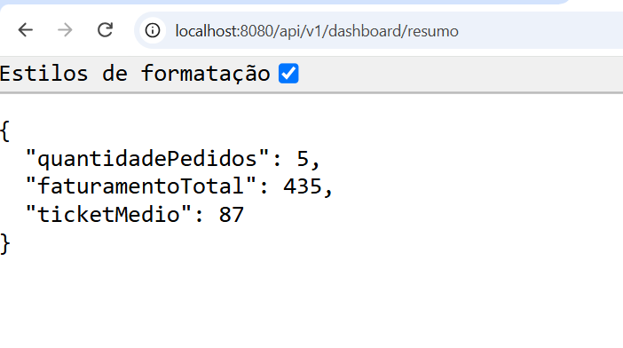
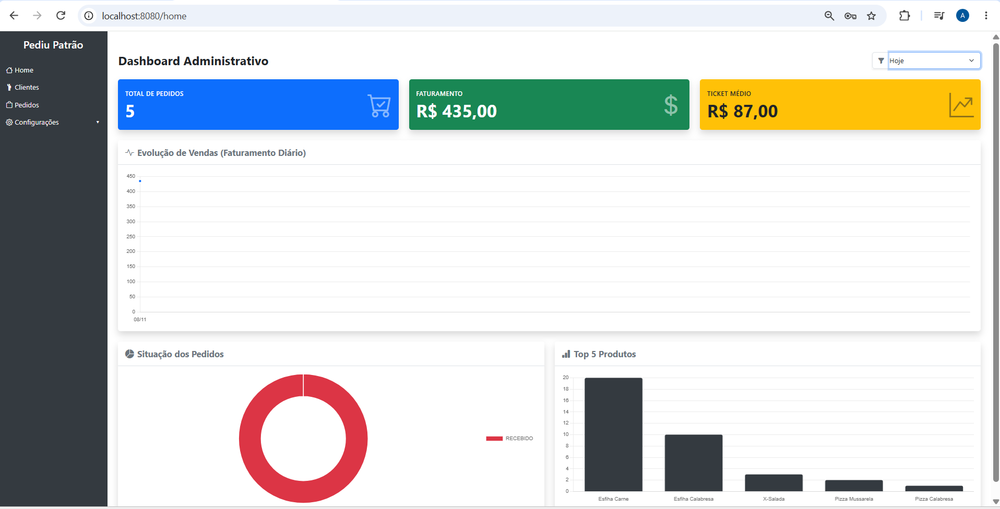

# Documentação Técnica — Dashboard Administrativo (PediuPatrão)

## 1. Requisitos do Sistema

### Requisitos Funcionais

- **RF01 — Indicadores gerais de vendas:**  
  O painel deve exibir em tempo real o total de pedidos, o faturamento bruto e o ticket médio do período selecionado.

- **RF02 — Análise de vendas (Gráficos):**  
  Apresentar a evolução temporal do faturamento diário por meio de um gráfico de linhas.

- **RF03 — Situação dos pedidos:**  
  Exibir a distribuição quantitativa dos pedidos de acordo com o seu status atual (ex.: Recebido, Em Preparação, Finalizado) utilizando um gráfico de rosca.

- **RF04 — Produtos mais vendidos:**  
  Listar o ranking (Top 5) dos produtos com maior volume de vendas, representados por meio de um gráfico de barras.

- **RF05 — Filtros de consulta:**  
  Disponibilizar filtros de período para recálculo dinâmico dos indicadores do dashboard.

- **RF06 — Integração com API REST:**  
  O dashboard deve consumir dados exclusivamente através de endpoints REST que retornem informações em formato JSON.

- **RF07 — Tratamento de períodos sem vendas:**  
  O sistema deve apresentar valores zerados quando não houver registros para o período solicitado, evitando falhas na interface.

### Requisitos Não Funcionais

- **RNF01 — Backend:**  
  A API deve ser desenvolvida utilizando Java e Spring Boot.

- **RNF02 — Persistência:**  
  Os dados devem ser armazenados e consultados a partir do MongoDB.

- **RNF03 — Visualização:**  
  Os gráficos devem ser renderizados utilizando a biblioteca Chart.js.

- **RNF04 — Responsividade:**  
  A interface deve ser adaptável para diferentes resoluções de tela.

- **RNF05 — Segurança:**  
  Os endpoints devem exigir autenticação e autorização adequadas para acesso gerencial.

---

# 2. Documentação da API REST

## Informações Gerais

**Base URL**

```http
/api/v1/dashboard
```

**Método de autenticação**

Acesso restrito a usuários autenticados com perfil gerencial.

**Formato de resposta**

```http
Content-Type: application/json
```

---

## Filtro de Período

Todos os endpoints aceitam o parâmetro de consulta:

```http
?periodo=
```

Valores suportados pelo frontend:

```text
hoje
7dias
30dias
mes
```

### Exemplos

```http
GET /api/v1/dashboard/resumo?periodo=hoje
```

```http
GET /api/v1/dashboard/resumo?periodo=7dias
```

```http
GET /api/v1/dashboard/resumo?periodo=30dias
```

```http
GET /api/v1/dashboard/resumo?periodo=mes
```

---

## 2.1 Resumo de Indicadores Gerais

Retorna os dados utilizados nos cards superiores do dashboard.

### Endpoint

```http
GET /api/v1/dashboard/resumo
```

### Exemplo de Requisição

```http
GET /api/v1/dashboard/resumo?periodo=hoje
```

### Exemplo de Resposta

```json
{
  "quantidadePedidos": 5,
  "faturamentoTotal": 435.00,
  "ticketMedio": 87.00
}
```

### Campos Retornados

| Campo | Tipo | Descrição |
|---------|---------|---------|
| quantidadePedidos | Integer | Quantidade total de pedidos no período |
| faturamentoTotal | Decimal | Soma total das vendas |
| ticketMedio | Decimal | Valor médio por pedido |

---

## 2.2 Tendência de Vendas

Retorna os dados cronológicos utilizados para construção do gráfico de linha de faturamento.

### Endpoint

```http
GET /api/v1/dashboard/tendencia
```

### Exemplo de Requisição

```http
GET /api/v1/dashboard/tendencia?periodo=hoje
```

### Exemplo de Resposta

```json
[
  {
    "data": "2026-11-08",
    "faturamento": 435.00
  }
]
```

### Campos Retornados

| Campo | Tipo | Descrição |
|---------|---------|---------|
| data | String | Data da venda no formato YYYY-MM-DD |
| faturamento | Decimal | Faturamento registrado na data |

---

## 2.3 Situação dos Pedidos

Retorna a quantidade de pedidos agrupados por status.

### Endpoint

```http
GET /api/v1/dashboard/status
```

### Exemplo de Requisição

```http
GET /api/v1/dashboard/status?periodo=hoje
```

### Exemplo de Resposta

```json
[
  {
    "status": "RECEBIDO",
    "quantidade": 5
  },
  {
    "status": "EM_PREPARACAO",
    "quantidade": 3
  },
  {
    "status": "FINALIZADO",
    "quantidade": 10
  }
]
```

### Campos Retornados

| Campo | Tipo | Descrição |
|---------|---------|---------|
| status | String | Status do pedido |
| quantidade | Integer | Quantidade de pedidos naquele status |

---

## 2.4 Ranking de Produtos Mais Vendidos

Retorna os produtos mais vendidos para exibição no gráfico de ranking.

### Endpoint

```http
GET /api/v1/dashboard/ranking-produtos
```

### Exemplo de Requisição

```http
GET /api/v1/dashboard/ranking-produtos?periodo=hoje
```

### Exemplo de Resposta

```json
[
  {
    "nomeProduto": "Esfiha Carne",
    "quantidadeVendida": 20
  },
  {
    "nomeProduto": "Esfiha Calabresa",
    "quantidadeVendida": 10
  },
  {
    "nomeProduto": "X-Salada",
    "quantidadeVendida": 3
  },
  {
    "nomeProduto": "Pizza Mussarela",
    "quantidadeVendida": 2
  },
  {
    "nomeProduto": "Pizza Calabresa",
    "quantidadeVendida": 1
  }
]
```

### Campos Retornados

| Campo | Tipo | Descrição |
|---------|---------|---------|
| nomeProduto | String | Nome do produto |
| quantidadeVendida | Integer | Quantidade total vendida |


---

# 4. Possíveis Erros HTTP

| Status | Descrição |
|----------|------------|
| `200 OK` | Requisição processada com sucesso. |
| `401 Unauthorized` | Usuário não autenticado ou sessão expirada. |
| `403 Forbidden` | Usuário sem permissão para acessar os dados do dashboard. |
| `500 Internal Server Error` | Erro interno durante o processamento dos dados ou agregações do MongoDB. |

---

# 5. Tecnologias Utilizadas

## Backend

- Java 17+
- Spring Boot
- Spring Security
- Spring Data MongoDB
- MongoDB

## Frontend

- Thymeleaf
- Bootstrap 5
- Bootstrap Icons
- JavaScript (ES6+)
- Chart.js

## Arquitetura

- Arquitetura em camadas
- API RESTful
- Comunicação JSON
- Dashboard responsivo
- Controle de acesso baseado em Roles (`ADMIN`, `GERENTE` e `ATENDENTE`)

----

# 6. Evidências de Testes

## Teste do Endpoint de Resumo

A imagem abaixo demonstra a execução do endpoint responsável por fornecer os indicadores principais do dashboard.



Resultado obtido:

```json
{
  "quantidadePedidos": 5,
  "faturamentoTotal": 435,
  "ticketMedio": 87
}
```

## Dashboard Administrativo em Execução

A imagem abaixo apresenta o dashboard integrado à API, exibindo os indicadores, gráfico de evolução de vendas, situação dos pedidos e ranking de produtos.



----

# 7. Vídeo Apresentação
## Link: https://youtu.be/YMpfiLRbWC4